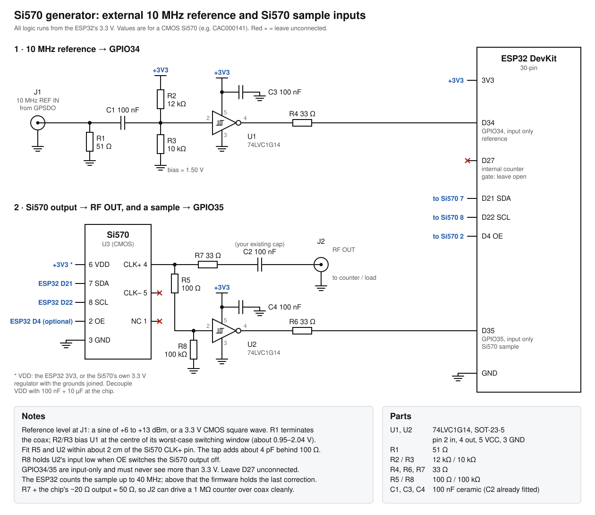

# Si570 Signal Generator (ESP32-WROOM-32)

A 10–160 MHz signal generator (wider with LVDS/LVPECL Si570 grades), with up to three more
outputs from an optional Si5351, built from:

- a Skyworks/Silicon Labs **Si570** programmable oscillator, driven by KO7M's Si570
  driver (vendored and fixed, see [lib/Si570/README.md](lib/Si570/README.md))
- a **30-pin ESP32-WROOM-32 DevKit** (on-board antenna) with a **web page** for frequency and every setting,
  live status, and **OTA firmware updates** (from the page or from PlatformIO)
- optional: a **16x2 LCD (PCF8574 backpack)** *or* a **0.96" 128x64 OLED**, detected at
  boot, and a **rotary encoder with push switch**
- optional: an **external 10 MHz reference**, selectable against the Si570's internal crystal
- optional: a **Si5351** clock generator on the same I²C bus, whose **CLK0–CLK2** become
  three more outputs (8 kHz–160 MHz), driven by Etherkit's
  [Si5351Arduino](https://github.com/etherkit/Si5351Arduino) library

The encoder and display can be added later. Without them the generator runs headless,
controlled from the web page or the USB serial console, and no rebuild is needed when
you plug them in.

> Status: tested on an ESP32 with a Si570 CAC000141: web page, API, Digest auth, OTA
> updates and Si570 tuning (checked with a counter) work. **Not yet tested on hardware:**
> the Si5351 outputs (the web page was tested against a simulated device), the external
> reference loop, the encoder and the displays.

## First test: ESP32 + Si570 only

1. Wire the Si570: **SDA → GPIO21, SCL → GPIO22, VDD → 3V3, GND → GND** (plus 2.2–4.7 kΩ
   pull-ups to 3.3 V if your Si570 board has none). Optionally OE → GPIO4.
2. Flash over USB once: `pio run -e esp32 -t upload`. This also installs the OTA partition
   table; later updates can go over Wi-Fi.
3. With no Wi-Fi configured, the generator opens a hotspot **`Si570-Setup-XXXX`**. Join
   it and open **http://192.168.4.1/** (most phones pop the page up by themselves).
4. Under **Network**, enter your Wi-Fi details, save, and reboot. The page is then at
   **http://Si570-SigGen.local/**. The IP address is also printed on the serial log and
   shown on the display if one is fitted.
5. Under **Si570 hardware**, check the I²C address, start-up frequency and register bank
   against your part number. If the start-up frequency is wrong, the page says which
   value the part probably has.
6. Set an **admin password** under *Admin password*. Until you do, anyone on the network
   can retune the generator or replace its firmware.

You can do the same over USB without Wi-Fi: open `pio device monitor` and type `help`.

## Web page

The page shows the frequency on an LCD-style display, updated live (WebSocket on port
81, falling back to polling if that's blocked).

- **Outputs** (with a Si5351 fitted): a button per output (Si570, CLK0, CLK1, CLK2)
  showing its frequency and RF state. The selected output is the one the display, the
  tuning controls and RF/drive act on, here and on the LCD/encoder alike.
- **Tune** by scrolling on a digit, tapping its upper or lower half, using **−/+**
  (hold to repeat) with the step selector, the arrow keys, or typing a frequency.
- **Output and reference:** RF on/off for the selected output (the Si570 needs OE wired),
  Si5351 drive strength (2–8 mA), the Si570's INT/EXT reference with lock status and
  crystal correction, *Calibrate now*, and *Save as power-on default* (all outputs).
- **Si5351 hardware:** fitted yes/no, I²C address, crystal (25 or 27 MHz), ppm
  correction and frequency limits, plus *Calibrate from a measurement* (see below).
- **Si570 hardware:** I²C address, start-up frequency, register bank (7 or 13), OE
  polarity, frequency limits and reference frequency. Stored on the device; the values in
  `include/config.h` are only the defaults.
- **Network:** SSID, password (never sent back to the page; leave blank to keep it) and
  hostname. Applies after a reboot. An empty SSID means "use the set-up hotspot".
- **Admin password:** protects the page, every change and both OTA paths. User `admin`,
  HTTP Digest auth (never sent in clear). If you lose it, type `auth clear` on the serial
  console.
- **Firmware update** and **Backup and maintenance**: download/restore settings (no
  passwords), reboot, factory reset.

Changes from the page, the encoder and the serial console all go through the same
controller, so the display and every open browser show the same state.

### API

The page uses a small JSON API that other tools can use too. GET routes are open and
read-only; POST routes need the admin password once one is set.

| Route | |
|---|---|
| `GET /status` | live state (also pushed on `ws://<host>:81/` every 250 ms) |
| `GET /config` | settings without secrets; `?download=1` as a backup file |
| `GET /discover` | identity, ports and endpoints; mDNS service `_si570-siggen._tcp` |
| `POST /api/freq` | `hz=14250000`, optional `output=0..3` (0 = Si570, the default; 1–3 = CLK0–CLK2) |
| `POST /api/step` | `index=0..8` (1 Hz … 100 MHz) |
| `POST /api/rf` | `on=1\|0`, optional `output=0..3` |
| `POST /api/output` | `output=0..3`: select the output the display and encoder work on |
| `POST /api/drive` | `output=1..3`, `ma=2\|4\|6\|8`: Si5351 drive strength |
| `POST /api/ref` | `mode=int\|ext` |
| `POST /api/calibrate`, `/api/save` | calibrate now / save as power-on default |
| `POST /save/hardware`, `/save/network`, `/save/admin` | settings forms |
| `POST /update` | firmware `.bin` (multipart), reboots when done |
| `POST /reboot`, `/factory_reset` | `factory_reset` needs `confirm=YES` |

```sh
curl -X POST -d hz=7050000 --digest -u admin:PASSWORD http://Si570-SigGen.local/api/freq
```

## Firmware updates

- **From the page:** *Firmware update* → choose `.pio/build/esp32/firmware.bin` → upload.
- **From PlatformIO over Wi-Fi (ArduinoOTA):**
  ```sh
  read -s 'SIGGEN_ADMIN_PASSWORD?Admin password: '; export SIGGEN_ADMIN_PASSWORD   # zsh; keeps it out of history
  pio run -e esp32-ota -t upload
  # or, if .local names don't resolve:  ... -t upload --upload-port 192.168.1.50
  ```
  If an upload stops part-way (`Broken pipe`), run it again. The running firmware is
  untouched until an upload completes. Keep `pio device monitor` open during the
  upload to see why: the board prints `[ota] error N` (3 = it stopped receiving data,
  4 = the image failed its check).
- **Over USB:** `pio run -e esp32 -t upload`. This is needed the first time, to install
  the `min_spiffs` partition table with two 1.9 MB app slots; the firmware is about
  1.16 MB.

After an update the generator restarts on its **saved power-on frequency**, not the one
it was on before.

## Serial console

`pio device monitor` (115200 baud), then:

| Command | |
|---|---|
| `out 0..3` / `out clk1` | select the output (`f`, `rf` and `drive` act on it) |
| `f 14250000` / `f 14.25M` / `f 7050k` | set frequency |
| `drive 2\|4\|6\|8` | Si5351 drive strength (mA) |
| `step 0..8` | tuning step (1 Hz … 100 MHz) |
| `rf on\|off`, `ref int\|ext`, `cal`, `save` | as on the page |
| `status` | status JSON |
| `wifi <ssid> [password]` | join a network and reboot (SSIDs without spaces) |
| `auth clear` | remove the admin password and reboot |
| `reset` | factory reset (all settings, Wi-Fi, password) and reboot |
| `reboot` | |

## Si5351 outputs

Connect a Si5351 module (Adafruit or a clone) to the same I²C bus: **SDA → D21, SCL →
D22, GND**, and power as the module expects (most have their own 3.3 V regulator and take
`VIN`/5 V or 3V3). Its address is 0x60, so it doesn't clash with the Si570 (0x55) or the
displays. The firmware finds it at power-up, or within 2 s of it being plugged in.
Without one, set *Si5351 fitted* to *No* and the extra outputs disappear.

- **Range:** 8 kHz–160 MHz by default (the library goes 4 kHz–225 MHz; the datasheet
  guarantees 200 MHz). Square-wave outputs; 2/4/6/8 mA drive is roughly +3 to +10 dBm.
- **Above 100 MHz** an output needs a PLL to itself. CLK0 and CLK1 share PLLA, CLK2 has
  PLLB: so CLK2 and *one* of CLK0/CLK1 can be above 100 MHz together. The page tells you
  when a setting is refused for this reason.
- **Accuracy:** the module's 25 MHz crystal is typically 10–30 ppm off, and the external
  10 MHz reference input only corrects the Si570. Two ways to fix that:
  - **Calibrate once from a measurement** (crystal stays on the board): select a CLK
    output, measure it with a counter you trust (e.g. locked to your GPSDO), and enter
    the reading under *Si5351 hardware → Calibrate from a measurement*. The page works
    out the correction (+ = crystal runs fast) and stores it; it applies to all three
    outputs. The crystal still drifts a few ppm with temperature.
  - **Lock it to a GPSDO** by replacing the crystal with a GPS-locked 25 MHz clock: see
    below. Every output is then exactly on frequency, at any frequency.

The Si5351 library is **GPL-3.0**: firmware binaries built from this project include it
and are therefore GPL-3.0 as a whole.

### Locking the Si5351 to a GPSDO

Breakout boards (Adafruit and clones) use the **Si5351A**, which has no reference input:
the reference input CLKIN (10–100 MHz) exists only on the Si5351C. But the crystal input
**XA** accepts a clock in place of the crystal (datasheet section 5.6, "Applying a
Reference Clock at XTAL Input"): **25 or 27 MHz, about 1 V p-p, through 0.1 µF, with XB
left unconnected**. The PLLs then run from the GPSDO, so all three outputs are locked to
it at every frequency, with no correction loop and no 40 MHz limit (unlike the Si570's
reference loop).

1. **Set one GPSDO output to exactly 25 MHz.** A programmable GPSDO such as the
   LBE-1421 can do this; its other output can keep feeding 10 MHz to the Si570's
   reference input.
2. **Remove the 25 MHz crystal** from the board. On the 10-pin chip, pin 1 (dot) is VDD,
   **pin 2 is XA** and pin 3 is XB; the crystal sits across pins 2 and 3. Find which
   crystal pad goes to pin 2 with a meter.
3. **Wire the clock to that pad:**

   ```
   GPSDO 25 MHz ── coax ── attenuator ──┬── 0.1 µF ── XA (crystal pad to pin 2)
                                        51 Ω
                                        │
                                       GND (board ground)       XB pad: unconnected
   ```

4. **Keep the level down.** XA's absolute maximum is **−0.5 V to +1.3 V**, and the
   datasheet drives it with about **1 V p-p**. A 3.3 V logic clock, even through the
   capacitor, exceeds that and can damage the chip. Terminate the coax in 51 Ω at the
   board and reduce the level with an inline attenuator (6–10 dB) or the GPSDO's lowest
   drive setting; check it with a scope if you can. Err on the low side: the input
   amplifier squares up a small signal.
5. **On the web page**, under *Si5351 hardware*: crystal **25 MHz**, correction **0**.
   No firmware change is needed.
6. **Check** any CLK output with your GPSDO-locked counter: it should read exactly the
   set frequency.

Notes:

- Once the crystal is gone, the board only works with the GPSDO connected.
- 10 MHz straight into XA is outside the datasheet's 25–27 MHz range. It is reported to
  work, but it isn't guaranteed; use 25 MHz when the GPSDO can make it.
- The firmware doesn't yet check the Si5351's PLL lock status, so a missing or too weak
  clock on XA is not flagged: the outputs simply go wrong. Check with a counter after
  wiring it up.
- A Si5351C module could take the 10 MHz reference directly on CLKIN instead; the
  firmware would need a small change to select that input.

## How "external 10 MHz reference" works with an Si570

The Si570 has **no reference input**. Its pins are OE, SDA, SCL, VDD, GND and CLK±
only, and it always runs from its internal ~114.285 MHz crystal. So the external
reference can't clock the chip directly. Instead the ESP32 runs a
**frequency-locked loop**:

1. Two ESP32 pulse-counter units count the 10 MHz reference and a buffered sample of the
   Si570 output over the *same* gate (one GPIO gates both, so they open and close on the
   same clock edge).
2. `Si570 frequency = 10 MHz × Si570 count ÷ reference count`. The ESP32's own clock
   error cancels out. With a 1 s gate the resolution is about 0.1 ppm.
3. The error is fed back as a corrected crystal frequency for the driver's RFREQ
   maths. Corrections of a few ppm use the Si570's glitch-free "Freeze M" path, so the
   output never drops out.

| Selection | Crystal value used for the maths |
|---|---|
| **INT** | Factory calibration read from the Si570 at power-up (datasheet: ±1.5 ppm initial, plus ±7/20/50 ppm over temperature depending on grade), plus your correction if you set one (see *Correcting the Si570 on the internal reference*) |
| **EXT** | Measured against the 10 MHz reference, updated every second while the output is ≤ 40 MHz. Above that the ESP32 can't count the output, so the last correction is **held**. The last EXT calibration is saved, so EXT stays accurate even with the reference unplugged. |

**Calibrate now** (on the page, or long press in REF mode with EXT selected): if the
output is above 40 MHz, it is moved to 10 MHz for a few seconds and counted until
locked, then restored.

## Wiring

Pin numbers are GPIOs. On the 30-pin DevKit the header labels are `D21`, `D22` and so on.
This is the common DOIT DevKit V1 layout, seen from the top with the antenna up. Some
clones order the pins differently, so go by the printed labels:

```
                    antenna
                  EN o     o D23
                  VP o     o D22  <- SCL: Si570, Si5351, display
                  VN o     o TX0
   10 MHz ref -> D34 o     o RX0
 Si570 sample -> D35 o     o D21  <- SDA: Si570, Si5351, display
    encoder A -> D32 o     o D19
    encoder B -> D33 o     o D18
   encoder SW -> D25 o     o D5
                 D26 o     o TX2
 (leave open)    D27 o     o RX2
                 D14 o     o D4   <- Si570 OE (optional)
 (leave open)    D12 o     o D2   (blue LED)
                 D13 o     o D15
                 GND o     o GND  <- Si570 GND
      5 V USB    VIN o     o 3V3  <- Si570 VDD, pull-ups
                      USB
```

| Function | ESP32 GPIO | Connect to |
|---|---|---|
| I2C SDA | 21 | Si570, Si5351 and display SDA |
| I2C SCL | 22 | Si570, Si5351 and display SCL |
| Encoder A / CLK (optional) | 32 | encoder CLK |
| Encoder B / DT (optional) | 33 | encoder DT |
| Encoder switch (optional) | 25 | encoder SW (other side to GND) |
| Si570 OE (optional) | 4 | Si570 pin 2 (RF on/off) |
| 10 MHz reference in (optional) | 34 | reference after the squaring circuit below |
| Si570 sample in (optional) | 35 | Si570 output via a buffer, see below |
| Counter gate | 27 | **nothing**: used internally, leave unconnected |
| 3V3 | 3V3 | Si570 VDD, OLED VCC, pull-ups |

I2C addresses: Si570 `0x55`, Si5351 `0x60`, OLED `0x3C`/`0x3D`, LCD backpack `0x27`/`0x3F` (any
PCF8574/PCF8574A address works).

The external reference and the Si570 sample input, with part values
([PNG](docs/ext-ref-wiring.png); drawn by [tools/ext_ref_schematic.py](tools/ext_ref_schematic.py)):



### Hardware notes

- **The Si570 is a 3.3 V part. Its SDA/SCL absolute maximum is VDD + 0.3 V.** Most 16x2
  LCD backpacks are powered from 5 V and have 4.7 kΩ pull-ups to 5 V on SDA/SCL. Connected
  directly, they put 5 V on the Si570 and ESP32 pins. Use a bidirectional I2C level
  shifter (a BSS138 module, or the BS170 circuit in AA0ZZ's QEX article, Fig. 7) between the
  3.3 V bus and the backpack. Alternatively, run the LCD at 3.3 V if your module supports
  it (3.3 V LCDs exist; many 5 V ones lose contrast).
- The OLED modules run happily at 3.3 V. Power them from 3V3.
- Keep the I2C bus pulled up to 3.3 V (2.2–4.7 kΩ). With an LCD connected the firmware
  runs the bus at 100 kHz (PCF8574 limit), otherwise at 400 kHz.
- Decouple the Si570 VDD with 100 nF + 10 µF right at the chip. It draws about 90–120 mA.
  If the ESP32 boot-loops (`invalid magic number` / `csum err` on the serial log) once
  the Si570 is powered, the board's 3.3 V regulator is sagging. Give the Si570 its own
  3.3 V regulator fed from `VIN`, with the grounds joined.
- **Leave D12 (GPIO12) unconnected.** It is a strapping pin. Pulled high at power-up, it
  switches the flash supply to 1.8 V and the board won't boot.
- If an upload stops at `Connecting...`, hold the board's **BOOT** button until the
  upload starts. Some 30-pin boards' auto-reset circuit is too slow.
- **10 MHz reference input** (schematic above): 51 Ω termination → 100 nF → 74LVC1G14
  biased at 1.50 V by 12 kΩ / 10 kΩ → 33 Ω → GPIO34. 1.50 V is the centre of the 1G14's
  worst-case switching window at 3.3 V (about 0.95–2.04 V), so the input needs about
  1.1 V p-p. That means a sine of **+6 to +13 dBm**, or a 3.3 V CMOS square wave such as a
  GPSDO output. For weaker sine references use a comparator (e.g. TLV3501) instead.
- **Si570 sample input:** for a CMOS Si570, tap CLK+ right at the pin through 100 Ω into
  a second 74LVC1G14 (100 kΩ pull-down on its input), then 33 Ω → GPIO35. The tap
  doesn't disturb the RF output. LVDS/LVPECL parts need a differential
  receiver/comparator instead.
- **RF output into a counter:** fast CMOS edges ring on unterminated coax and can make a
  counter read double. Either use the counter's 50 Ω input (through the 100 nF), or put
  33 Ω in series at CLK+ when the counter input is 1 MΩ.
- **OE polarity** depends on the part number. Most parts are active-high, with an
  internal 17 kΩ pull-up, so RF stays on if OE is left open. Set the polarity on the web
  page (or `kPinSi570Oe = -1` in [include/config.h](include/config.h) if OE is unwired).

## Configure for your Si570

Set these on the web page under **Si570 hardware** (defaults in
[include/config.h](include/config.h)). They **must** match your part number; check it
with Skyworks'
[part number lookup](https://www.skyworksinc.com/en/Application-Pages/Timing-Lookup-Customize).

| Setting | Meaning |
|---|---|
| Start-up frequency | Factory power-on frequency (e.g. 10 MHz for 570CAC000107DG, 56.32 MHz for SoftRock parts). A wrong value scales every frequency. The firmware detects this and shows the start-up frequency it thinks your part has. |
| Register bank | `7` if the 2nd option letter is A/B (±50/±20 ppm), `13` if it is C (±7 ppm) |
| Lowest / highest frequency | 10–160 MHz for CMOS; higher for LVDS/LVPECL/CML grades |

`include/config.h` also holds the pins, encoder steps per detent and direction, display
type (auto / LCD / OLED, SSD1306 vs SH1106), hostname, gate time and lock threshold.

### Correcting the Si570 on the internal reference

Without the external reference, the Si570 runs on its factory calibration. To trim it:

1. Select the **Internal** reference and set the Si570 to a convenient frequency. Higher
   is better: a counter with 1 Hz resolution resolves 0.1 ppm at 10 MHz but 0.01 ppm at
   100 MHz.
2. Measure it with a counter you trust, ideally one locked to your GPSDO.
3. Under **Si570 hardware → Calibrate from a measurement**, enter the reading.

The page works out the correction (+ = crystal runs fast) and stores it on the device.
It applies at every frequency, and you can repeat it: each new reading refines the stored
value. It is reset if you change the Si570's address, start-up frequency or register
bank, and the *Correction* field shows the current value, which you can also type in or set
back to 0. With the external reference selected, the live correction from the reference
takes over.

## Build

Requires [PlatformIO](https://platformio.org/) (VS Code extension or CLI).

```sh
pio run -e esp32 -t upload     # build and flash over USB
pio device monitor             # serial log and console at 115200 baud
pio test -e native             # host unit tests (no hardware needed)
```

## Encoder controls (optional)

| Action | TUNE | STEP | OUT | REF | RF |
|---|---|---|---|---|---|
| Turn | frequency ± step | change step (1 Hz – 100 MHz) | select output (Si570, CLK0–2) | CW = EXT, CCW = INT | CW = on, CCW = off |
| Short press | next mode | next mode | next mode | next mode | next mode |
| Long press (0.8 s) | save as power-on defaults | save | save | EXT: **calibrate now**; INT: save | save |

- TUNE, STEP and RF act on the selected output.
- OUT only appears with the Si5351 fitted; REF only on the Si570 when the reference
  counter is configured; RF on the Si570 only when OE is wired.
- The display returns to TUNE after 10 s without input.
- **Hold the encoder switch while powering up** to restore the generator defaults
  (frequency, step, reference, RF). Wi-Fi, password and hardware settings are kept.
- Settings are only written to flash on an explicit save or after a successful
  calibration, never while tuning.

## Display (optional)

16x2 LCD:

```
  14.250 000 MHz     <- Si570 only: cursor under the digit being tuned (blinks in STEP mode)
CK1   7.074 000      <- with the Si5351: output tag (570, CK0, CK1, CK2), then the frequency
TUNE 1kHz     INT    <- mode, step, reference status (Si570) or ON/OFF (Si5351)
OUT  <CK1> 8mA       <- OUT mode: the output being selected and its drive
```

OLED: reference status (or the Si5351 output and drive) on top, large frequency with the
tuned digit underlined (boxed in STEP mode), step, and a bottom line with the current mode
highlighted next to the selected output and its RF state. Wi-Fi events (IP
address, hotspot name, OTA progress) show on the bottom line for a few seconds.

Reference status: `INT` internal · `LOCK` within 0.5 ppm of the reference · `TRK`
correcting · `HOLD` output above 40 MHz or RF off, last correction kept · `NREF` no
10 MHz reference · `NSIG` no Si570 sample on GPIO35 · `CAL` calibrating.

## Project layout

```
include/config.h      pins, defaults, firmware version
web/index.html        the web page (embedded in the firmware at build time)
lib/Si570/            KO7M Si570 driver (MIT), ESP32 port with bug fixes
lib/SigGenCore/       hardware-independent logic (encoder, button, UI modes,
                      frequency formatting, reference-loop maths), unit tested on the host
src/controller.*      the one place that changes the generator (encoder, web, console)
src/web_portal.*      HTTP routes, JSON API, WebSocket feed, firmware upload
src/net.*             Wi-Fi station / set-up hotspot, mDNS, ArduinoOTA
src/settings.*        NVS storage: state, hardware, network, admin password
src/clockgen.*        the Si5351 (CLK0-CLK2) through Etherkit's Si5351Arduino (GPL-3.0)
src/                  also: Si570 wrapper, pulse counter, reference loop, displays, encoder
test/                 host tests, with a simulated Si570 that enforces the datasheet rules
tools/build_stamp.py  writes the build time shown in /status and the boot banner
tools/ext_ref_schematic.py  draws docs/ext-ref-wiring.svg (reference + sample inputs)
```

The web and OTA design follows the SO2R/BPF controller
(`BandPassFilterController/ESP32_SO2R_TCI`): set-up hotspot with captive portal, Digest
admin password shared with OTA, `/status` + `/config` + `/discover`, a WebSocket live
feed on port 81, and the `min_spiffs` partition table.

## References

- Skyworks (formerly Silicon Labs) Si570/Si571 datasheet, Rev. 1.6
- Craig Johnson AA0ZZ, "Programmable PLL (Si570) Local Oscillator", QEX Jul/Aug 2011
  (also presented at the ARRL/TAPR DCC 2012)
- KO7M Si570 driver: https://github.com/ko7m/Si570
- Etherkit Si5351Arduino: https://github.com/etherkit/Si5351Arduino
- Skyworks (Silicon Labs) AN619, "Manually Generating an Si5351 Register Map"
- Skyworks (formerly Silicon Labs) Si5351A/B/C-B datasheet, Rev. 0.75: XA as a clock
  input (section 5.6, Fig. 16), absolute maximum ratings, 10-MSOP pinout (Table 13)
